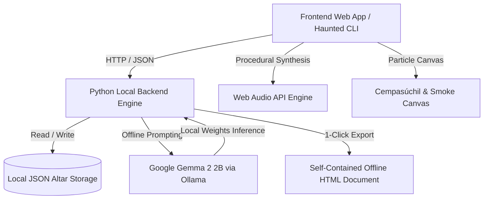

# 🕯️ Ofrenda AI: Ghost in the Machine

> *"Solo muere quien es olvidado."* — Only those who are forgotten truly die.

[](https://opensource.org/licenses/MIT)
[](https://ai.google.dev/gemma)
[](https://ollama.com)
[](https://dev.to/challenges/hf26)

**Ofrenda AI** is a sacred, local-first digital memorial altar (*ofrenda*) and spirit communion interface built for **Hacktoberfest 2026 (Week 4: Ghost in the Machine)** and the spirit of **Día de los Muertos**. 

Powered by **Google's open-weight Gemma 2 2B model** running 100% locally on your machine via Ollama, **Ofrenda AI** bridges the line between past and present without sending a single byte of private family memories or ancestral photos to any corporate cloud.

---

## 🌟 Why Open Innovation Matters: The Core Principle

Día de los Muertos is not about fear; it is about love, memory, and sacred connection across the veil. But modern digital life poses a profound threat to memory:

1. **Sacred Privacy for Raw Grief:**
   Family photos, personal eulogies, and intimate stories about our departed ancestors must **never** be monetized, scraped into commercial datasets, or logged on remote corporate ad servers. With local open-weight **Gemma**, inference stays strictly inside your device's memory.
2. **Immunity to Cloud Rot & Digital Extinction:**
   Closed SaaS platforms shut down, change terms, lock data behind paywalls, or go bankrupt. If your digital altar lives on a proprietary cloud server, it dies when the startup dies. **Ofrenda AI** uses open weights and local plain text files that will open and run 40 years from now with no internet connection.
3. **Remembrance with the Lights (and the Wi-Fi) Off:**
   Traditional Día de los Muertos is celebrated in quiet, sacred spaces lit only by candle flames. You can take your laptop to an off-grid cemetery, a darkened room, or a remote family cabin with Wi-Fi switched completely off. The ghost in the machine answers directly from the silicon.

---

## ✨ Features

- **🏛️ Traditional 3-Tier Sacred Altar:**
  - **Top Tier (*El Cielo*):** Sacred spirit portrait, years of life, life summary, spiritual tags, and interactive candles.
  - **Middle Tier (*La Tierra*):** Favorite earthly offerings — pan dulce, spiced coffee, heirloom shawls, books, code cards, and personal letters.
  - **Bottom Tier (*Los Elementos*):** The 4 sacred elements — pure water to quench the spirit's thirst after their journey across Mictlán, salt for purification, copal incense smoke, and golden cempasúchil (marigold) petal trails.
- **🕯️ Realistic Candle Flame Physics:**
  - Interactive clickable candles. Click to light or blow out. Dynamic radial lighting, subtle flame jitter, and chime audio feedback.
- **🔮 Spectral Séance with Gemma 2:**
  - Commune with the spirits of history or departed ancestors in an intimate, poetic typewriter dialogue.
  - Pre-configured historical computing altars:
    - **Ada Lovelace** (1815–1852): The Enchantress of Numbers & Mother of Computing.
    - **Alan Turing** (1912–1954): Father of Computer Science & Morphogenetic Visionary.
    - **Dennis Ritchie** (1941–2011): Co-creator of C and UNIX.
    - **Abuela Elena & The Ancestors**: Warm ancestral family altar.
  - Custom altar builder for your own loved ones, mentors, or departed pets.
- **🎵 Pure Procedural Web Audio Soundscape:**
  - Wind whispering through marigolds (procedural pink noise).
  - Crackling candle ember pulses.
  - Resonant harmonic singing bowl chime (432Hz) on candle lighting.
  - **Zero external audio files** — synthesized live using pure Web Audio API math.
- **🌼 Fluttering Cempasúchil & Smoke Canvas:**
  - High-performance canvas particle system with wind drift, 3D petal tumbling, and rising copal incense smoke.
- **📜 Standalone Offline Archival Export:**
  - Generates a 100% self-contained single-file HTML memorial document that can be kept on a USB drive or printed forever.
- **💀 Haunted Terminal / NecroCLI:**
  - A companion terminal application (`cli/haunted_cli.py`) with ASCII calavera art, candle lighting commands, and a `haunt` mode where the spirit critiques your shell commands.

---

## 🏗️ System Architecture



---

## 🚀 Quickstart

### Prerequisites
1. **Python 3.10+** (Standard library only; zero mandatory third-party pip dependencies!).
2. **Ollama** installed with Gemma 2:
   ```bash
   ollama pull gemma2:2b
   ```
   *(If Ollama is not installed or running, Ofrenda AI automatically falls back to its built-in offline poetic remembrance engine!)*

### Running the Web Altar (Windows)
Double-click `run.bat` or run:
```bash
python backend/app.py 8080
```
Then open [http://localhost:8080](http://localhost:8080) in your browser.

### Running the Haunted Terminal CLI
Double-click `run_cli.bat` or run:
```bash
python cli/haunted_cli.py
```

### Running the Automated Test Suite
```bash
python tests/test_suite.py
```

---

## 💀 Terminal Commands in Haunted CLI

```text
  list               - List all spirit altars
  select <id>        - Commune with an altar (e.g. 'select alan-turing')
  candles            - View and light/extinguish candles
  offerings          - View sacred offerings placed on the altar
  haunt <command>    - Possessed terminal: spirit reflects on a shell command
  status             - Display local Gemma engine & air-gap verification
  <any message>      - Speak directly with the spirit
```

---

## 🏆 Hacktoberfest 2026 Alignment

| Category | Qualification |
| --- | --- |
| **Theme: Ghost in the Machine** | Bridges Halloween night and Día de los Muertos by bringing the spirits of computing history and personal ancestors to life through open-source AI. |
| **Featured Partner: Best Use of Gemma** | Uses **Google Gemma 2 2B** open-weight model directly via Ollama for sub-second, warm, poetic, and philosophical spirit inference. |
| **Open Innovation Core** | 100% offline, private, zero telemetry, air-gapped memorial preservation. |

---

## 📄 License

MIT License &copy; 2026 Shashiharan Ram Vanam.
Dedicated with reverence to all who came before us.
